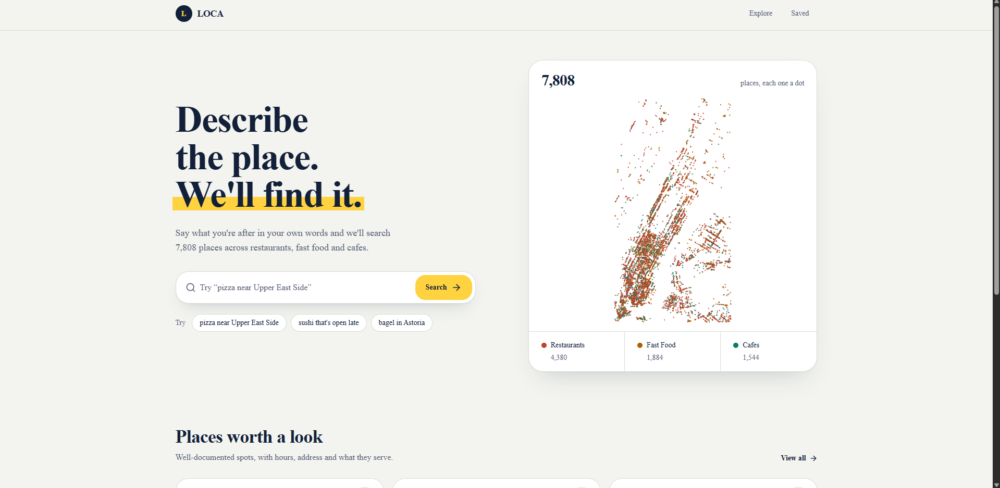
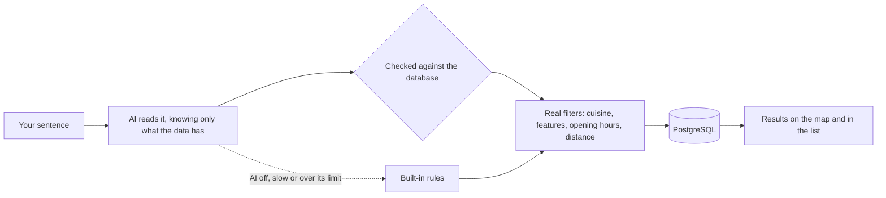

<div align="center">

# 📍 LOCA

<!--  -->

**Find the right place by describing it, in your own words.**

Type _"late-night pizza with outdoor seating near Union Square"_ (in English, Persian or any language) and LOCA turns it into real filters over real data: cuisine, features, opening hours and distance.

<p>
  
  
  
  
  
  
</p>

  <p>
    <a href="https://loca-flame.vercel.app/"><b>Live demo</b></a> ·
  </p>



</div>

---

## ✨ About

Most place-finding apps make you pick filters. **LOCA lets you just say what you want.**

An AI reads your request, but it is only allowed to use what the data can really answer. Everything it returns is checked against the database before a single query runs, so it can't invent a neighborhood, a cuisine or a feature that does not exist. Where the data has no answer (is it _quiet_? is it _cheap_?), LOCA says so instead of guessing.

The places come from [OpenStreetMap](https://www.openstreetmap.org/): about 7,808 restaurants, cafes and fast-food spots in Manhattan and right next to it.

## 🚀 Features

### 🧠 Search that understands you

- Describe what you want in a sentence, in **any language**.
- Understands **category** (restaurants, cafes, fast food), **cuisine** (pizza, thai, sushi...), **features** (outdoor seating, wifi, vegan, delivery, takeaway, wheelchair accessible...), **opening hours** ("open now", "open late", "Sunday brunch") and **distance** ("near Union Square", 39 neighborhoods and landmarks).
- **Never an empty page.** If nothing matches everything, LOCA loosens one condition at a time (fewer features, a wider area, no time) and tells you exactly what it dropped.
- **Honest about gaps.** Things the data can't answer are reported ("Can't filter by cozy, because there is no data on that yet").
- **Works without AI too.** If the AI is off, slow or over its limit, built-in rules take over, so search never breaks.
- **Built to stay cheap:** repeated searches come from a cache, and each visitor and the whole site have usage limits.

### 🗺️ Explore

- Interactive map (MapLibre) with category-colored markers and a compact info card for each place.
- Category filter with live counts, an **Open now** toggle and pagination, all with proper loading states.
- Place cards show what the place serves, whether it is open right now, its street address and how far it is.

### 🔖 Saved places

- Save places and come back to them. Saved places live in your browser, no account needed.

## 🔎 How search works



A few examples:

| You type                                             | LOCA applies                                                                                          |
| ---------------------------------------------------- | ----------------------------------------------------------------------------------------------------- |
| `italian with outdoor seating near union square`     | cuisine **italian** + feature **outdoor seating** + within ~0.4 mi of **Union Square**, nearest first |
| `cafes with wifi, open now`                          | category **Cafe** + feature **wifi** + **open right now**                                             |
| `late night pizza near union square`                 | cuisine **pizza** + **open at 11 PM** + near Union Square                                             |
| `یه کافه با وایفای که الان بازه`                     | the same as above, written in Persian, answered in Persian                                            |
| `vegan pizza with outdoor seating near union square` | nothing lists all of it, so it keeps _outdoor seating_ and says it left out _vegan_                   |

## 🧰 Built with

- **[Next.js 16](https://nextjs.org/)** (App Router, Cache Components, Turbopack) and **[React 19](https://react.dev/)**
- **[TypeScript](https://www.typescriptlang.org/)**
- **[Tailwind CSS 4](https://tailwindcss.com/)** and **[shadcn/ui](https://ui.shadcn.com/)** (Base UI)
- **[Prisma 7](https://www.prisma.io/)** with **PostgreSQL** (hosted on **[Supabase](https://supabase.com/)**)
- **[MapLibre GL](https://maplibre.org/)** with **[OpenFreeMap](https://openfreemap.org/)** tiles
- Any **OpenAI-compatible** model (through the `openai` SDK) for understanding searches
- **[OpenStreetMap](https://www.openstreetmap.org/)** for the place data

## 🏁 Getting started

### Prerequisites

- [Node.js](https://nodejs.org/) 20 or newer (includes `npm`)
- A PostgreSQL database. A free [Supabase](https://supabase.com/) project works well.
- _(Optional)_ An API key for an OpenAI-compatible model, to turn on AI search. Without it, search uses the built-in rules.

### Installation

1. **Clone the repository**

   ```bash
   git clone https://github.com/ProfessorMR/loca.git
   cd loca
   ```

2. **Install the dependencies**

   ```bash
   npm install
   ```

3. **Set your environment variables**

   ```bash
   cp .env.local .env
   ```

   Then open `.env` and fill it in (see the [table below](#-environment-variables)).

4. **Create the database tables**

   ```bash
   npx prisma generate
   npx prisma migrate deploy
   ```

5. **Load the places.** Import `new-york-places.csv` into the `Place` table (for example with Supabase's _Table Editor → Import data_). Then fill in the cuisine and feature tags from the GeoJSON that is in the repo:

   ```bash
   npx tsx scripts/enrich-tags.ts --dry-run   # shows what it would do, changes nothing
   npx tsx scripts/enrich-tags.ts
   ```

   This only touches the `tags` column, and it is safe to run more than once.

6. **Start the app**

   ```bash
   npm run dev
   ```

   Open [http://localhost:3000](http://localhost:3000).

> [!WARNING]
> Never commit your real `.env`. It is already in `.gitignore`; keep it that way.

### 🔑 Environment variables

| Variable       | Required | What it is                                                   |
| -------------- | :------: | ------------------------------------------------------------ |
| `DATABASE_URL` |    ✅    | Pooled Postgres connection string, used by the app           |
| `DIRECT_URL`   |    ✅    | Direct Postgres connection string, used by Prisma migrations |
| `XAI_API_KEY`  |          | API key of your AI provider                                  |
| `XAI_BASE_URL` |          | Base URL of an OpenAI-compatible API                         |
| `XAI_MODEL`    |          | Model name. It must support JSON mode                        |

The three `XAI_*` variables turn AI search on. Leave them empty and LOCA still works, with simpler rules.

## 🗂️ Project structure

```text
app/                    Pages and API routes (home, explore, place, saved)
components/shared/      UI: search bar, map, place cards, filters...
lib/
  places.ts             Search, filters, relaxation, category and tag vocabulary
  ai-intent-extractor.ts  The AI prompt and strict validation of its answer
  search-intent.ts      The built-in rules used when AI is unavailable
  nyc-areas.ts          Neighborhoods and landmarks for "near X" searches
  opening-hours.ts      Parser for OpenStreetMap opening hours ("open now")
  osm-tags.ts           Turns OpenStreetMap tags into cuisine and feature tags
  rate-limit.ts         Keeps the AI bill under control
prisma/                 Schema and migrations
scripts/                Data scripts (see below)
```

<details>
<summary><b>Data scripts</b></summary>

<br />

| Script                           | What it does                                                                                                                     |
| -------------------------------- | -------------------------------------------------------------------------------------------------------------------------------- |
| `scripts/enrich-tags.ts`         | Fills `Place.tags` (cuisine, outdoor seating, wifi, vegan...) from `new-york-places.geojson`. Run it after importing the places. |
| `scripts/convert-osm-places.mjs` | Converts the OpenStreetMap GeoJSON into the CSV used for the import.                                                             |
| `scripts/enrich-images.ts`       | _Experimental._ Looks up photos on Wikimedia Commons by name. Matches can be wrong, so review the results.                       |
| `scripts/import-osm-places.ts`   | An older importer that reads straight from Overpass. Its bounding box is set for Tehran, so change it before using it.           |

Run any of them with `npx tsx scripts/<name>.ts`.

</details>

## ⚠️ Good to know

- **Coverage:** Manhattan and the area right next to it. Neighborhoods outside it (Brooklyn, Queens...) are not covered, and LOCA says so instead of guessing.
- **Tags come from volunteers.** A missing tag does not mean the place lacks the feature, only that nobody wrote it down. The app says this wherever features are used.
- **No data on** ambiance (quiet, cozy), price, ratings or reviews. Search won't pretend to filter by them.
- **Saved places are local to your browser.** There are no accounts yet.
- **AI usage limits are kept in memory.** On a host that runs several copies of the server, each copy counts on its own. Great for an MVP; use a shared store such as Redis when traffic grows.

## 🤝 Contributing

Contributions are welcome:

1. Fork the project
2. Create your branch (`git checkout -b feature/amazing-feature`)
3. Commit your changes (`git commit -m "Add amazing feature"`)
4. Push to the branch (`git push origin feature/amazing-feature`)
5. Open a Pull Request

## 📬 Contact

**Mohammad Ramaji**: [@mohammad.\_.rmj](https://instagram.com/mohammad._.rmj)

Project link: [github.com/ProfessorMR/loca](https://github.com/ProfessorMR/loca)

## 🙏 Acknowledgments

- Place data © [OpenStreetMap contributors](https://www.openstreetmap.org/copyright), available under the [Open Database License](https://opendatacommons.org/licenses/odbl/). The credit is shown in the app's footer and must stay there.
- Map tiles by [OpenFreeMap](https://openfreemap.org/), rendered with [MapLibre GL](https://maplibre.org/).
- UI components from [shadcn/ui](https://ui.shadcn.com/), icons from [Lucide](https://lucide.dev/).

## 💖 Support

If LOCA helped you, or you simply like it, you can support its development. Every bit helps me keep improving it, and it is truly appreciated.

<a href="https://reymit.ir/professor_mr">
  
</a>

Starring the repo ⭐ and sharing it with a friend helps just as much.
